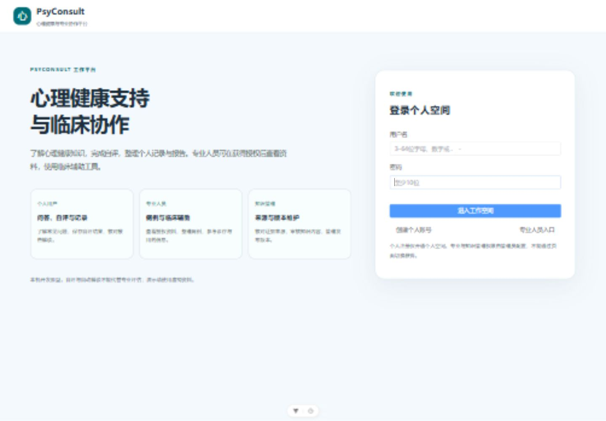

# 公众知识来源与检索第二轮验收

日期：2026-10-21。工作目录为 D:\PsyConsult-Fusion；原系统及保全包未被融合改动。本轮只作来源、适用范围和工程核对，不把机器核对登记为专家审核。

## 首页调整依据

参考[好心情](https://haoxinqing.cn/)的问答、测评及医生入口，[Headspace](https://www.headspace.com/)的具体功能与受众导航，以及[Wysa Copilot](https://www.wysa.com/wysa-copilot)对数字支持和专业协作的说明。采用“产品做什么、谁来用”的表达，不照搬这些产品的治疗效果或服务承诺。

标题改为“心理健康支持与临床协作”，说明为“了解心理健康知识，完成自评，整理个人记录与报告。专业人员可在获得授权后查看资料，使用临床辅助工具。”三张卡片按个人用户、专业人员、知识管理说明具体任务；标题字号和上方留白缩小。登录及专业权限流程保持原逻辑。



## 来源核对

16条登记全部建立 source_audit.json：13条读取官方页面/PubMed记录/官方PDF并核对一般适用范围；2条卫健委来源原站返回412，通过官方搜索索引或政府网转载内容核对；药监局门户本次抓取返回412，明确保留为查询入口待复核。没有把返回错误的页面记为已成功读取。

原 source_registry.csv 中“已核对”及其旧日期是导入时的来源声明，本次状态以独立 source_audit.json 为准。原始资料文件和40条用例不修改。所有章节仍为内部测试草稿，clinical_approval=false；正式中文量表题本及许可、中文摘要的医学审核和再发布许可仍未完成。

| 来源标识 | 本次核对状态 | 证据角色 | 限制 |
|---|---|---|---|
| WHO_MENTAL_DISORDERS_ZH_2026 | page_and_scope_checked | general_education | 限主题相关的概括科普；不构成个体诊断或治疗方案。 |
| WHO_DEPRESSION_ZH_2026 | page_and_scope_checked | general_education | 限主题相关的概括科普；不构成个体诊断或治疗方案。 |
| WHO_ANXIETY_ZH_2025 | page_and_scope_checked | general_education | 限主题相关的概括科普；不构成个体诊断或治疗方案。 |
| WHO_BIPOLAR_ZH_2025 | page_and_scope_checked | general_education | 限主题相关的概括科普；不构成个体诊断或治疗方案。 |
| WHO_SCHIZOPHRENIA_ZH_2025 | page_and_scope_checked | general_education | 限主题相关的概括科普；不构成个体诊断或治疗方案。 |
| WHO_STRESS_GUIDE_2020 | page_and_scope_checked | general_education | 限主题相关的概括科普；不构成个体诊断或治疗方案。 |
| WHO_SELFHELP_2026 | page_and_scope_checked | implementation_manual | 服务实施手册，不能把引用它等同于每个自助练习已获验证。 |
| NHC_12356_2024 | official_index_or_reprint_checked | service_policy | 通知支持全国号码和建设要求，不保证任何地区当前接通率或服务时段。原站412，核对官方索引和政府网转载。 |
| NHC_SERVICES_2025 | official_index_or_reprint_checked | service_policy | 2025年度服务建设要求，不是2026年具体医院地址、开放时间或现有服务清单。原站412，核对政府网转载。 |
| PHQ9_KROENKE_2001 | page_and_scope_checked | original_scale_research | 核对原始研究记录，不证明当前中文题本、翻译许可或个人诊断。 |
| GAD7_SPITZER_2006 | page_and_scope_checked | original_scale_research | 核对原始研究记录，不证明当前中文题本、翻译许可或个人诊断。 |
| NMPA_OFFICIAL_PORTAL | fetch_blocked_navigation_only | portal_navigation | 仅查询入口；不是任何具体药品、剂量、漏服或饮酒建议的证据。原站本次返回412，保留待复核。 |
| WHO_OCD_FACTSHEET_2023 | page_and_scope_checked | general_education | 官方区域办英文PDF；本地中文概述仍需医学审核和许可复核。 |
| WHO_STRESS_QA_2026 | page_and_scope_checked | general_education | 限主题相关的概括科普；不构成个体诊断或治疗方案。 |
| NIMH_ADULT_BSSA | page_and_scope_checked | adult_clinician_reference | 适用于ASQ筛查阳性的18岁及以上成人，由专业人员使用；不是PHQ第九题算法，也不应由公众自行操作评估。 |
| NIMH_MEDICATIONS | page_and_scope_checked | general_education | 一般用药教育，不支持个体选择、剂量或中国具体产品相互作用结论。 |

可追溯链接及具体日期见 [来源记录](../knowledge_sources/community/source_audit.json)。每次读入资料会检查16条来源是否齐全、URL是否与登记一致、章节是否有映射。审查通过的链接存在不等于整篇摘要已获医学批准。

原稿4个章节有部分细项未能从所列来源逐项核对：睡眠问题原因、睡眠求助、用药基本原则、用药常见问题。本次通过 section_overrides.json 提供收窄的摘要，保留原稿并用SHA-256绑定被替代段落；原段落发生变化时停止使用旧覆盖。漏服和饮酒问题明确缺少具体产品说明书，不推导补服量或相互作用结论。NIMH成人安全评估资料仅作成人专业参考，不作为PHQ第九题算法。

检索不会把药监门户用于普通用药问题的事实证据；仅在明确查询说明书或官网入口时允许返回。知识库维护要求与软件工程要求不作为公众科普检索证据。13+2条来源核对和4条收窄摘要仍不等同于对56个章节作过逐条专家医学审核。

## 检索与评测

由无权重词项相交改为BM25词项排序，纳入中文标题、章节名、正文长度和罕见词权重；补充常见表达变体及PHQ/GAD写法归一化，不调用额外网络模型。分数只用于排序，不是正确概率。

| 套件 | 用例数 | 任一来源命中 | 完整来源覆盖 | 解释 |
|---|---:|---:|---:|---|
| 第一版原始预期 | 39 | 87.18% | 79.49% | 原始基线 |
| 本轮原始预期 | 39 | 89.74% | 82.05% | 同一用例、同一预期，可比较；仍有7条不完整 |
| 本轮来源预期复核版 | 38 | 100% | 100% | 8条预期另行修订，2条行为题排除，不与原始指标混算 |
| 本轮新增表达变体 | 16 | 100% | 100% | 包含中英文、量表写法、漏服及无关问题；非盲测或临床验证 |

原始评测中的门户首页预期、紧急求助必须命中热线建设通知等问题记录在 evals/community_expectation_review.json。原始文件SHA-256仍为 ea35d0935faf8b49a04e6b1540047735d989cd74a475f051051eac4974479151。

原始KB006在本轮没有命中原预期的两个广义来源，检索到了睡眠章节的WHO压力问答。复核版采用该章节的实际来源。这一差异单列保留，不把修改预期描述为检索修复。其他原始未完整命中的条目及实际缺项见[结果摘要](evidence/community-retrieval-v2-summary.json)。

来源覆盖只证明取到了目标来源标识，不能证明章节支持每个句子、生成答案忠实或具有临床效果。对用药处方与无证据不编造的行为题，本轮不以来源命中代替回答行为验收。

## 生成回答中发现的问题和本轮修正

对虚构的统一补服剂量问题作真实模型测试时，发现模型没有给出数值剂量，但把本地摘要描述为规范性文件，并使用了不恰当的“违规”字样。来源命中不能避免这种归因错误，故没有把该次测试记为来源忠实性通过。

对于规则能明确识别的补服、停换药、药物合用、用药不适及个体选药/剂量问题，本轮改为固定的资料边界答复，不调用生成模型推导方案。引用只使用实际检索到的NIMH官方标题与链接，并明确其只支持一般用药教育、不支持具体产品结论。真实HTTP再次测试已返回该固定答复，无虚构规范表述，完成帧正常。

这套中文关键词规则不保证覆盖所有省略、跨轮指代或其他语言表达；其他科普回答仍由模型生成，尚未完成独立的逐句来源忠实性验证。不能把本轮修正描述为已消除全部幻觉风险。前后实测分别留在 .tools/round2-runtime-before-boundary.json 与 .tools/round2-runtime.json。

## 验证和复现

后端完整回归311项通过（包含17项新增来源、摘要失效、检索边界及用药操作答复测试）；前端原聊天协议9项及身份请求3项通过，类型检查与生产构建通过。已有LangChain弃用警告、前端依赖注释和大包提示保留。

```powershell
cd D:\PsyConsult-Fusion
.\.venv\Scripts\python.exe scripts/audit_community_sources.py --output .tools/source-audit.json
.\.venv\Scripts\python.exe scripts/evaluate_community_retrieval.py --suite legacy --output .tools/retrieval-legacy.json
.\.venv\Scripts\python.exe scripts/evaluate_community_retrieval.py --suite reviewed --output .tools/retrieval-reviewed.json
.\.venv\Scripts\python.exe scripts/evaluate_community_retrieval.py --suite paraphrase --output .tools/retrieval-paraphrase.json
```

legacy命令预期返回1，表示原始预期未全部满足；不应把它忽略或说成全通过。其余套件本轮返回0。结构审计成功只表示文件与映射一致。

下一阶段验收重点：由合适的专业审核人员逐句审查56节中文摘要、核对实际中文量表版本及许可；补具体药品现行说明书；增加独立编写的问法和生成答案忠实性验证。正式发布前仍须复核资料使用许可与本地服务可用性。
