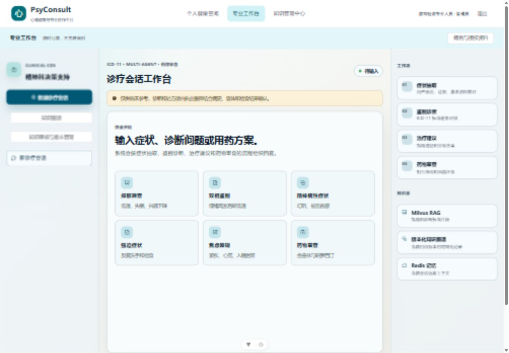
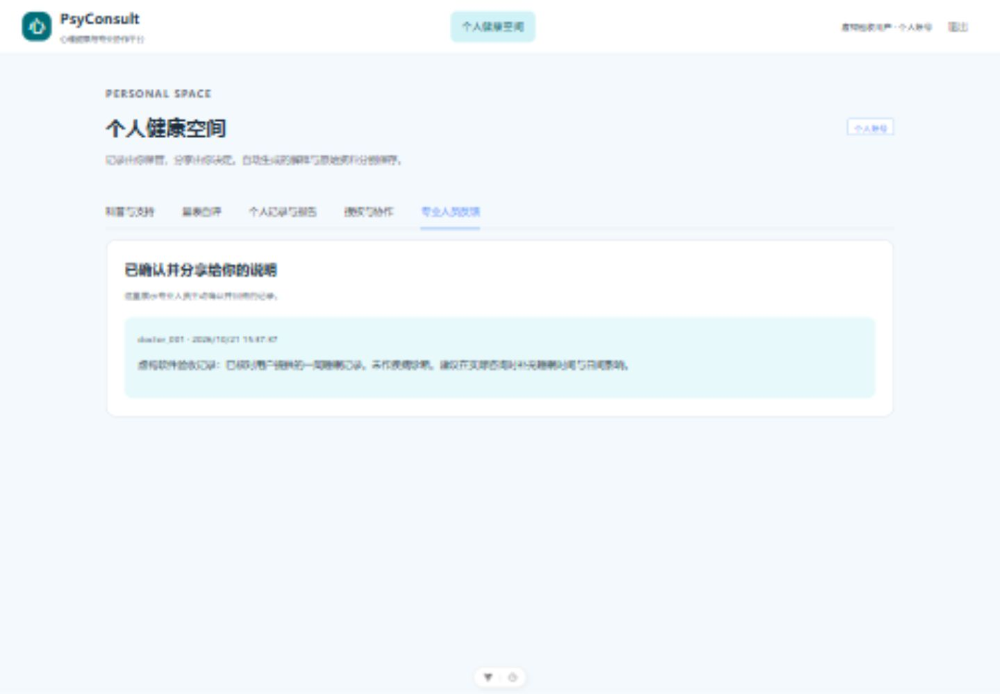
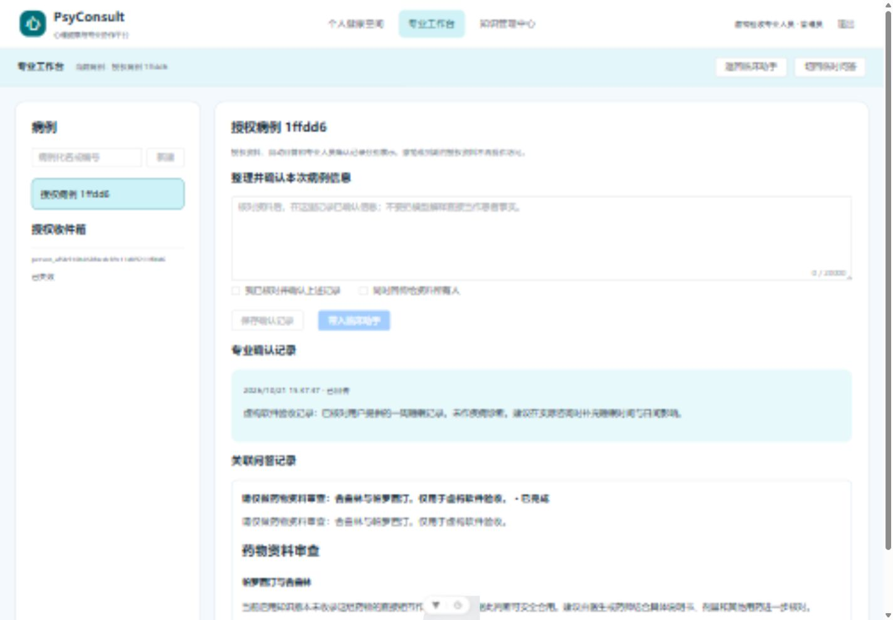

# 融合验收记录

日期：2026-10-21。范围：本机可运行的融合原型；未部署、未推送远端。虚构资料验收，不代表临床效果验证。

## 保留和恢复

- 冻结目录：`D:\PsyConsult`；完整保全包：`D:\PsyConsult-Preserved\20261021-pre-fusion-01`。
- 69,425 个文件，5,685,727,615 字节，SHA-256 核对无差异；配置、忽略文件、未提交文件和原 Git 历史均在保全包内。
- 导出 Redis、Milvus、Neo4j 数据及 Neo4j 日志卷、对应 Docker 镜像；在新卷中隔离恢复。Milvus 27 个集合名称及条数一致，Neo4j 1976 节点/1205 关系，Redis 恢复时 3617 键，原 SQLite 完整性及表条数一致。
- 证据：保全包 `metadata/verification.json`、`metadata/recovery-verification.json`。保全范围与 Redis 过期、外部浏览器限制见使用说明。
- 融合前功能提交 `2bec42893c793a47a2e929b6cbfc60c31e7f7eaf`。原工作台保留在 `src/App.vue`，新统一入口为 `PlatformApp.vue`。

最终再次逐文件复核：原项目代码、配置、数据及其他工作文件未变化；仅 Codex 桌面应用自动维护的两条 Git 捕获/检查点引用发生变化，保全包中的原 Git 快照仍完整保留。新增代码与前端产物没有新增模型密钥或 API 访问令牌暴露；原版中与本地开发令牌相同的示例文本仍按基线保留，正式部署前须替换开发凭据。

## 自动检查

| 检查 | 结果 |
|---|---|
| 原版恢复后后端基线 | 278 通过 |
| 融合完整后端 | 294 通过，1 项已有 LangChain 弃用警告 |
| 前端原聊天协议测试 | 9 通过 |
| 新前端身份与请求测试 | 3 通过 |
| TypeScript 类型检查、生产构建 | 通过；保留依赖注释和大包提示 |
| Python 134 项已安装分发依赖兼容性 | uv pip check 通过 |

测试覆盖个人角色越权、所有权、授权撤销与到期、确认与回传、病例隔离、量表计分、报告幂等、会话持久化与中断恢复、来源元数据、转写限制、旧令牌兼容。详细日志留在 `.tools/fusion-final-regression.log`；版本锁定在 `agent/requirements-fusion.lock`。

## 实际运行验收

- PDF、DOCX、PNG 虚构文档提取通过；PNG 经本地 OCR 保留预期数字。方法及结果在 `.tools/document-probes/results.json`。
- 实际模型报告解读完成（1336 字符），源文字哈希一致，重复分析复用结果。
- 用本机合成语音调用真实 ASR，返回预期英文句子；未访问用户麦克风。
- 病例临床流式药物资料审查完成，无错误帧；图谱和知识工作台接口均返回 200。答案如实说明当前知识版本缺少直接相互作用记录，没有据此宣称合用安全。
- 上述实测结果在 `.tools/runtime-acceptance/results.json`，只验证功能链路，不对模型解释准确性作临床背书。
- 浏览器完成：个人创建记录 → 仅选该记录授权 → 专业接收成病例 → 显式确认并回传 → 个人查看反馈 → 撤销 → 专业收件箱显示已失效，原授权快照消失，专业确认记录及关联问答保留。
- 原专业三列工作台、图谱、知识审核及版本入口可访问。桌面 1440 宽及窄屏布局检查完成。

## 来源借鉴与下一步

对方固定版本 `eazingpoe/PsyConsult@791e9c764b1292fac0db75cf3c4e9bfefe63593d`；原始系统为 xingdayup/PsyConsult。借鉴公众入口、科普问答、量表、语音、报告和章节来源资料；没有直接覆盖原临床图、数据库或知识审核体系。公众支持流程与专业推理分开，授权后通过病例衔接。

公众资料 12 篇/56 节，本地章节关键词检索；来源仍为内部测试草稿。保留对方原 40 条检索用例，排除 1 条行为题，39 条实际检索得到 top-3 任一来源召回 87.18%、完整来源覆盖 79.49%、宏平均覆盖 83.33%。未达到全部命中；这是来源检索覆盖评估，不是回答正确率。产物 `.tools/community-retrieval-baseline.json`，用例 `evals/community_retrieval.jsonl`。

建议下一阶段先做来源审查和未命中用例修复，再做公众/专业真实使用流程评审。还需正式中文量表版本核对、更加完整的风险表达评估、机构身份管理、单进程任务队列升级，以及模型/向量资料/图谱/公众资料的联合发布快照。本版是可验收原型，不是已完成上述工作的正式临床产品。
