# 登录入口视觉调整

2026-10-21，修改仅位于融合副本 D:\PsyConsult-Fusion。

采用深蓝与白色双栏布局；删除原有三张长说明卡片，保留平台名称、一句定位和三项功能概览。登录区统一输入尺寸、标签间距、按钮及边框；个人登录和专业入口直接切换，注册仍沿用原机制。移动端收起装饰图，优先呈现表单。

登录后的业务界面与认证脚本未改变，未新增账号体系或修改权限。开发调试悬浮工具默认关闭；需要时在启动Vite前设置 ENABLE_VUE_DEVTOOLS=1。

验证：前端身份请求3项、聊天协议9项测试通过；类型检查与生产构建通过。桌面1440宽及手机390宽检查完成，个人/专业切换及注册表单可用。已有依赖注释和大包提示保留。预览使用独立页，没有退出当前使用中的账号，也没有提交浏览器自动填充的凭据。

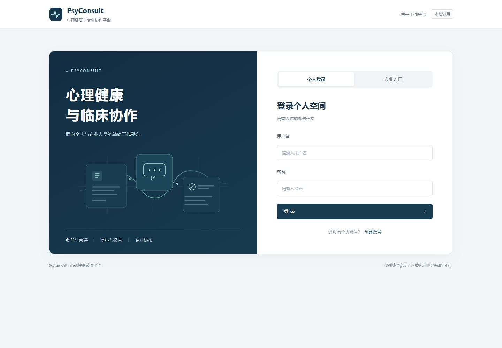

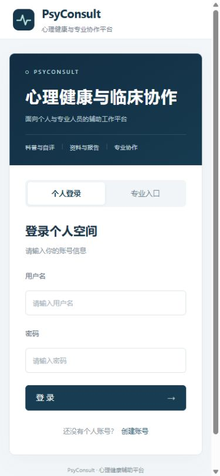

## 品牌比例与视觉收敛

根据用户反馈，页首字标从21px放大至32px、图形从40px放大至50px；封面采用54px的PsyConsult字标，手机端分别缩至28px、44px及36px。字标采用统一衬线字体，配合简洁中文标题、绿灰色实底和偏暖背景。去掉科技卡片连线插画和渐变，减少技术装饰。

用户提供的红色十字形图案未作为PsyConsult主标志加入：视觉上更接近医疗机构标识，和本产品品牌的关系尚未明确。本轮未改动附件图案。

验收：桌面1440宽和手机390宽检查完成，个人/专业入口切换正常；12项前端测试、类型检查及生产构建通过，原认证与业务脚本逐段比较一致。

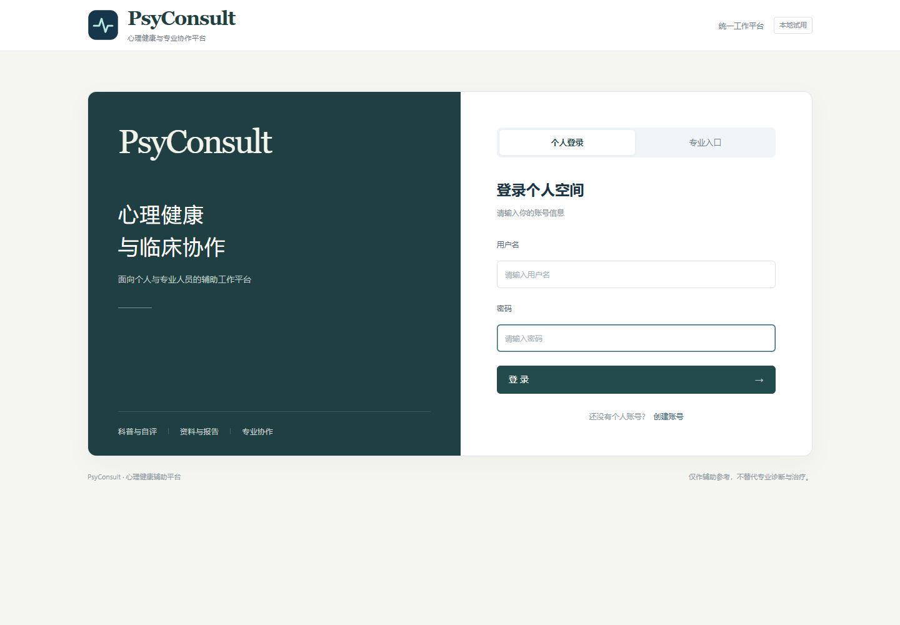

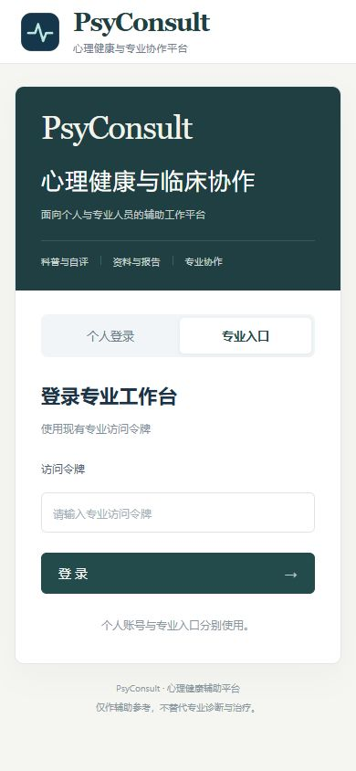

## 蓝色与心理健康图标

按用户最新偏好恢复蓝色封面、按钮及浅蓝灰背景，保留放大的PsyConsult字标。采用用户提供的第四张“侧脸与心形”图片作封面点缀，原始图片逐字节保留，圆形构图与浅蓝底通过CSS展示。未选用脑网络或电路图案。

科普、自评/资料、专业协作标签及登录方式使用现有Element Plus线性图标；用户名、密码、令牌输入框补充对应前缀图标。手机端收起较大的封面图片，保留小图标。仅新增静态图标导入，业务脚本比较一致。

验收：12项前端测试、类型检查和生产构建通过；桌面1440宽、手机390宽及专业入口切换已检查，新增图片在页面加载正常。

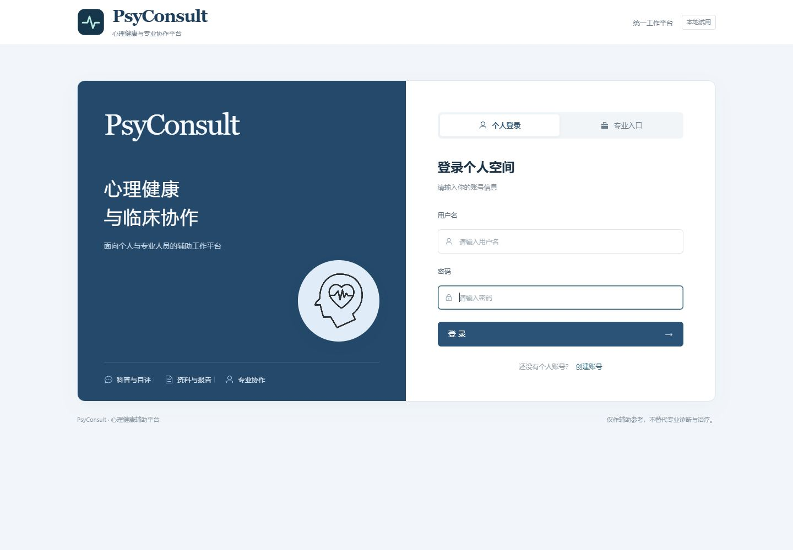

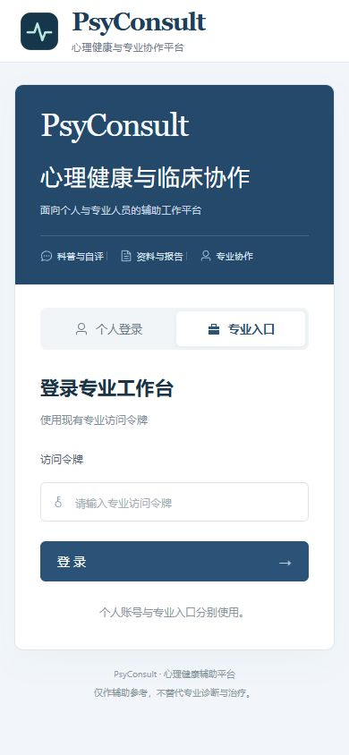

## 脑部品牌标识与背景

采用用户新提供的脑线框图作封面淡水印，原图字节不变，通过CSS灰度、反相与混合实现蓝底上的低对比度展示；背景不响应鼠标、不进入辅助阅读顺序，文字保持在独立上层。桌面背景透明度15%，手机端10%。独立圆形侧脸配图从封面收起，保留其素材文件。

品牌心电图换成简洁的双半球脑部SVG图标，登录前后共用，保留放大的PsyConsult字标。认证与业务脚本逐段比较一致。类型检查和生产构建通过，桌面1440宽、手机390宽及专业入口切换已检查。

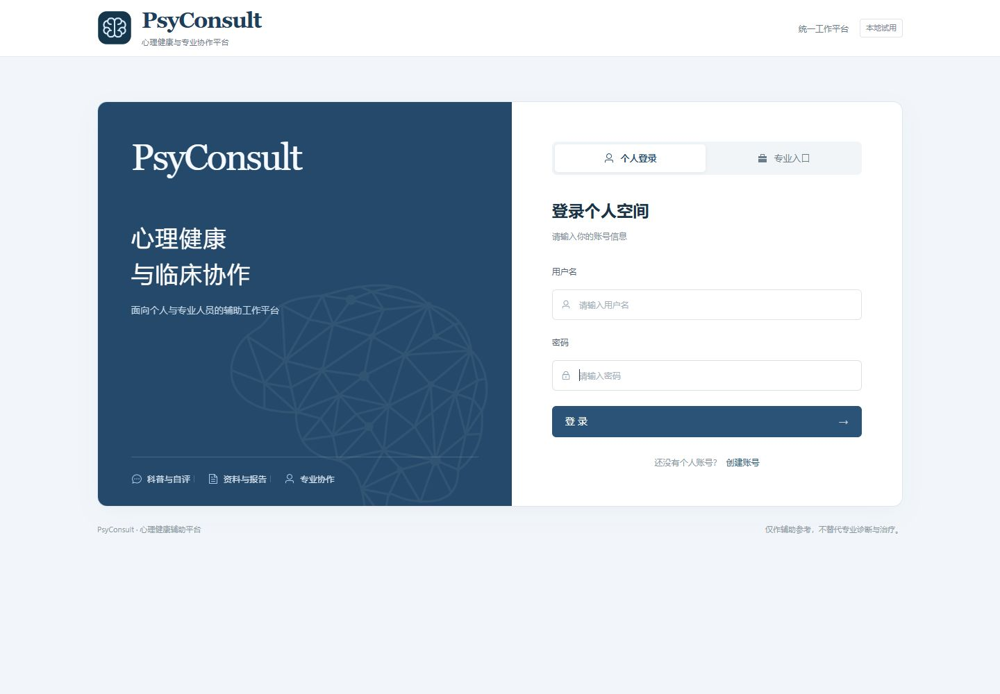

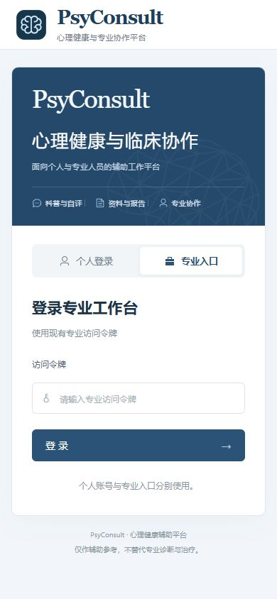

## 无底托的侧脸心形图案

按用户要求同时保留侧脸心形与脑线框图案。侧脸原图通过CSS反相、屏幕混合和透明度显示为浅蓝灰线条，取消白色圆形底托、边框和阴影。桌面置于封面右下方，手机缩小至字标右侧；脑线框进一步减淡，两种图案分层展示。

类型检查与生产构建通过，桌面和手机视觉检查完成，业务脚本比较一致。

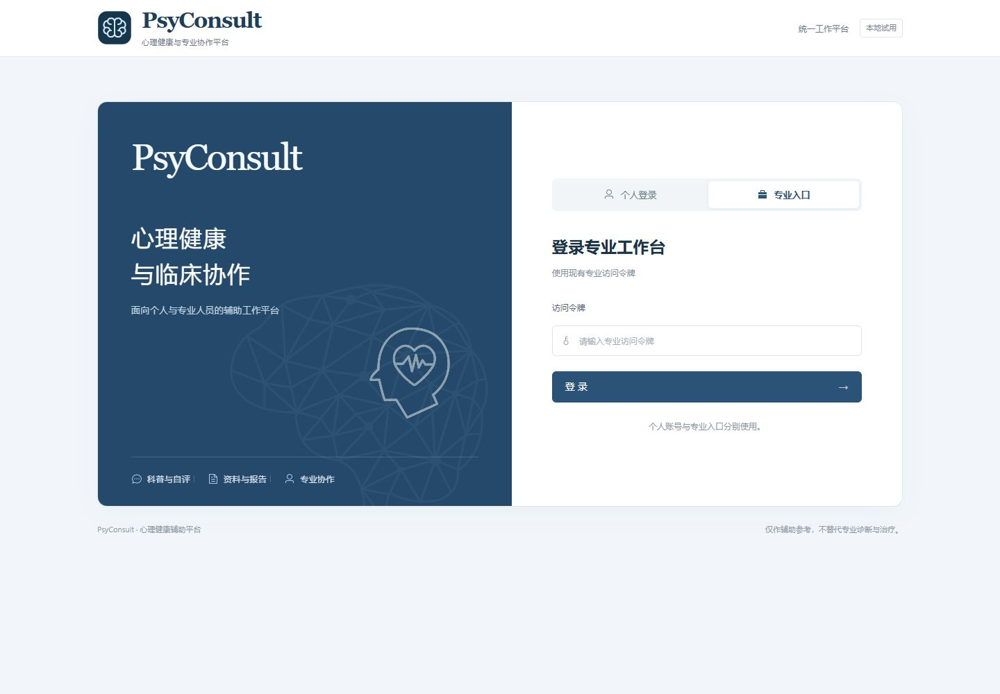

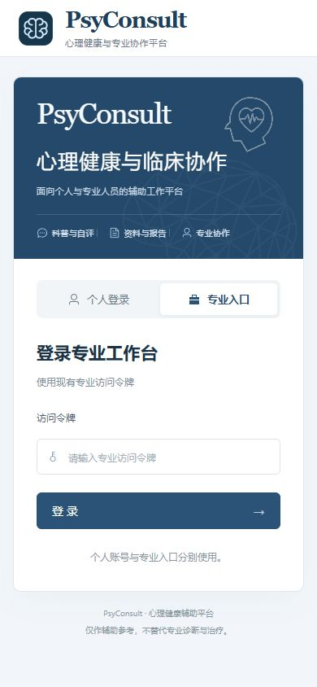

## 两个图案错位布局

侧脸心形移至封面右上方，脑线框保留于右下方淡背景；平板缩小侧脸与字标，手机进一步调整脑背景尺寸与位置，为两个图案留出间隔。两个图案不再叠放，保持原有蓝色、无白底和低对比度处理。

已检查1440px、800px与390px宽度，类型检查及生产构建通过，业务脚本比较一致。

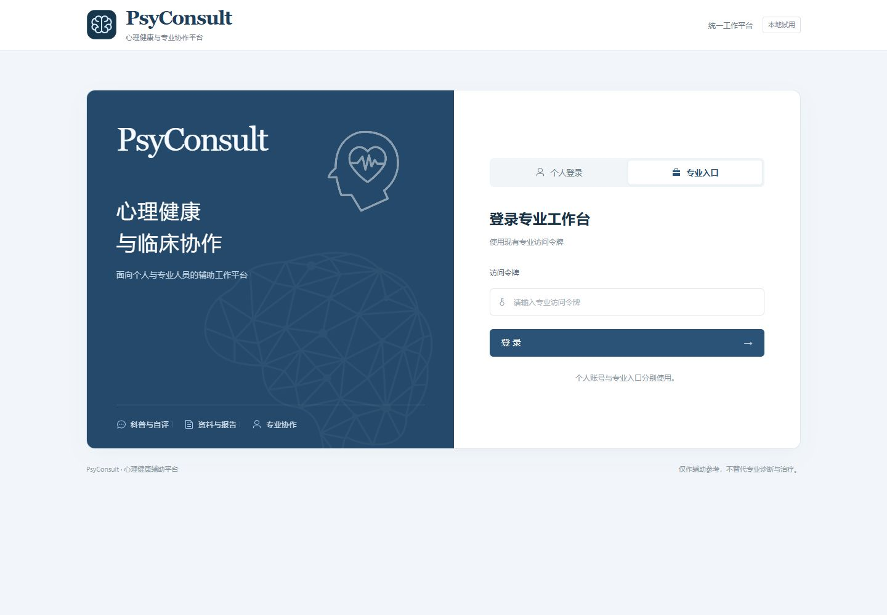

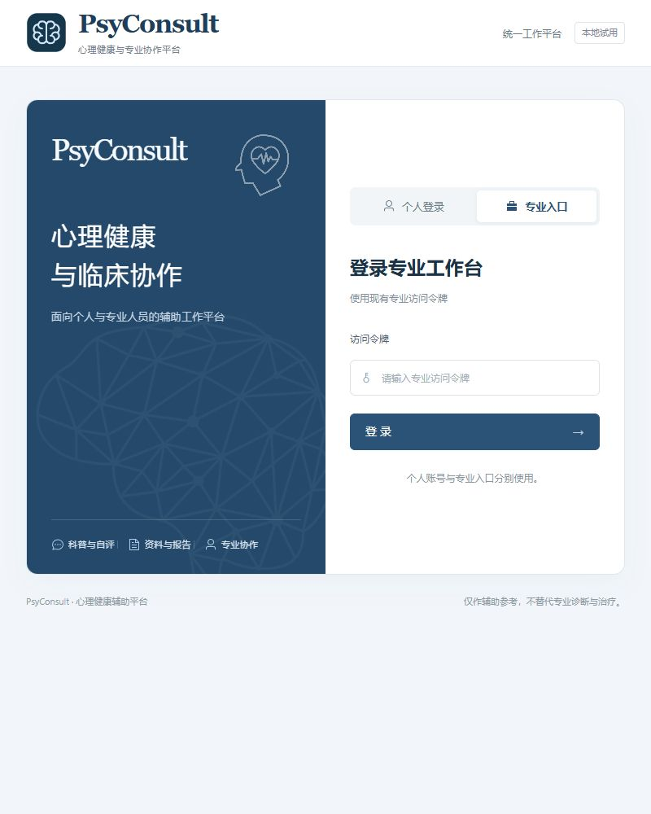

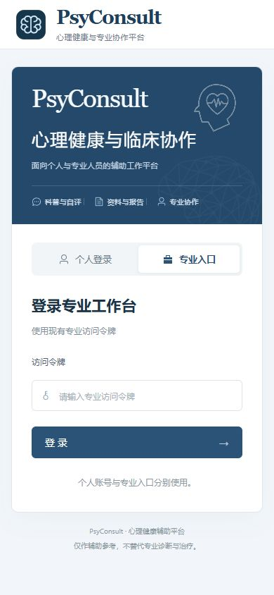

## 浅蓝整体构图

根据用户对突兀感的反馈，将封面改为浅蓝底与深蓝文字，侧脸和脑线框统一放在下方网格区域，采用相近的低对比度灰蓝线条。取消独立悬浮定位，两个图案具有各自空间；保留品牌脑图标、字标大小与蓝色按钮。手机端使用紧凑的装饰行。

类型检查、生产构建及桌面和手机视觉检查通过，业务脚本比较一致。

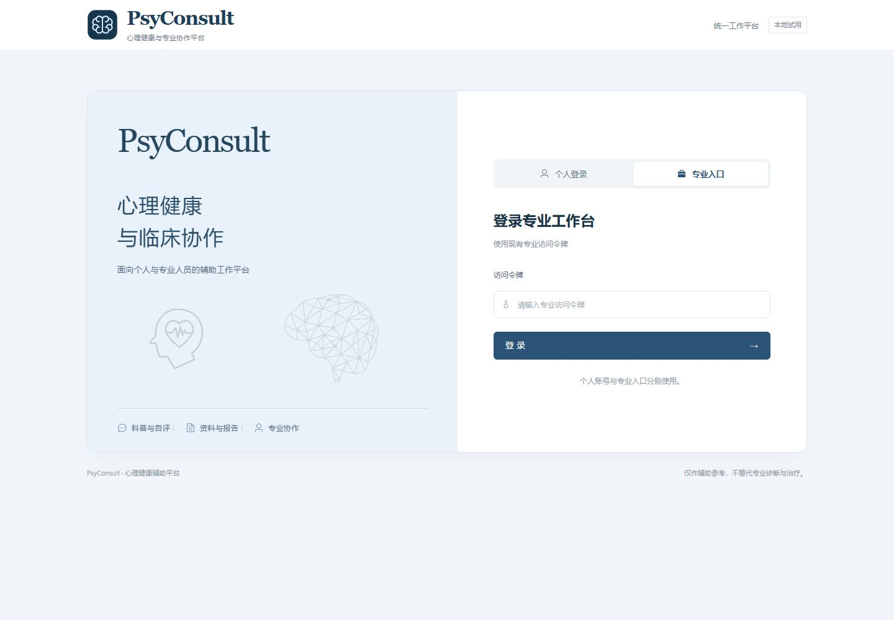

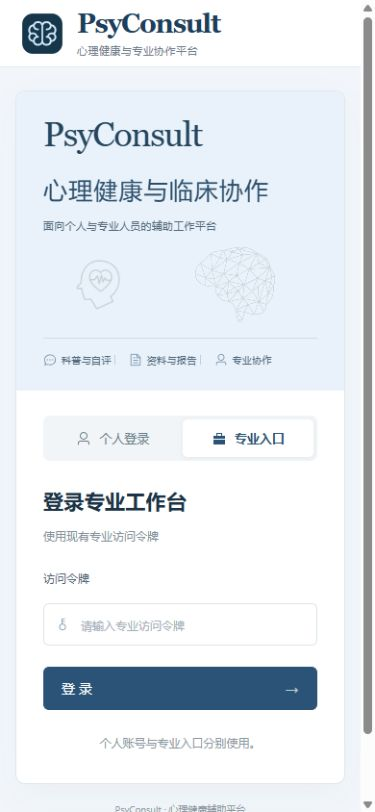

## 侧脸心形作为系统标识

根据用户指定，将侧脸心形原图缩小放在PsyConsult名称左侧，替换原脑部SVG。图形无外框和色块，原图文件未作像素修改，通过显示尺寸和裁切去除多余留白。桌面图形区域44×50px、手机38×44px；登录前后共用标识，封面布局保留。

桌面及手机视觉检查、类型检查与生产构建通过，业务脚本比较一致。

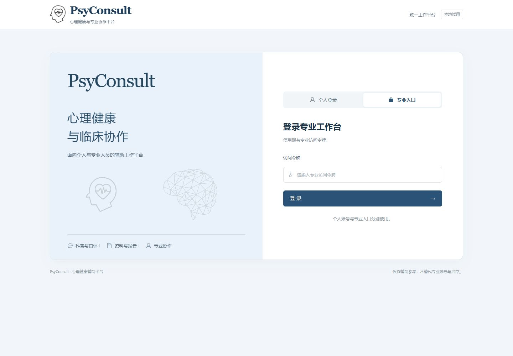

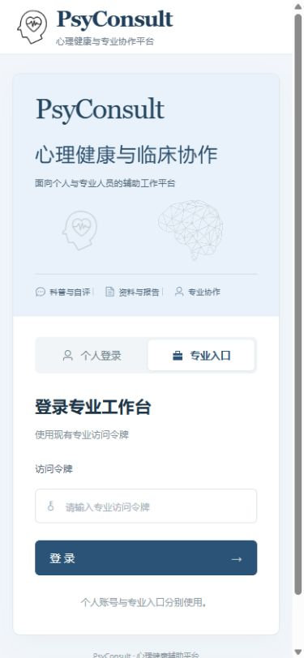
